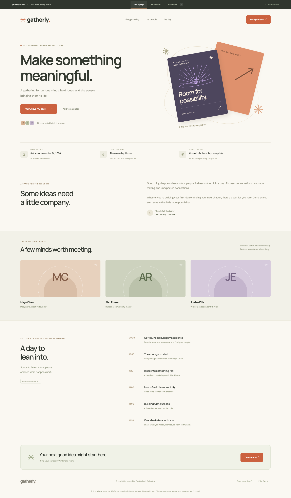

# Gatherly

[Open live app](https://mohdriyaazpersonal.github.io/gatherly/)



A complete browser-based event launch kit: a polished event page, editable agenda and speakers, local RSVP management, calendar invitations, and a printable flyer.

## Run

Node.js 22 or newer. No dependency installation needed.

```sh
npm start
npm test
npm run build
```

Visit the server URL printed in the terminal. The `dist/` folder is ready for a static host. Serve over HTTP because the app uses JavaScript modules.

## Features

- Responsive event landing page with venue details, speaker cards, agenda, and invitations to RSVP.
- Organizer editor for title, description, UTC dates, venue, contact, capacity, speakers, and agenda.
- Validated local RSVP forms with case-insensitive duplicate checks and capacity enforcement.
- Attendee search, check-in/undo, removal, and formula-safe CSV export.
- RFC-style `.ics` calendar downloads with UTC times, escaped text, and 75-byte line folding.
- Copyable event links that include event details in the URL fragment and support Unicode.
- Print stylesheet for an event flyer; use your browser's print dialog to save a PDF.
- Validated JSON workspace backup and restore, localStorage persistence, and a clearly fictional sample event.

## Data and limitations

**RSVPs are stored only in the browser where they are entered. No email is sent, and organizers do not receive remote registrations.** Shared links include event details, including the public organizer email, but never attendees. They do not merge RSVP lists across visitors. A production registration service would require a backend and access controls. The interface states this near every RSVP and guest list.

Dates and agenda times use UTC explicitly. Calendar apps convert the downloaded invitation into their configured timezone. Multi-day event dates are supported, while agenda times have no separate day field. Sharing uses an encoded URL fragment, so very long event descriptions produce long links. RSVP notes can contain personal information; keep exported backups private. Event and attendee data is removed if browser storage is cleared. Capacity is capped at 10,000; agenda and speaker counts at 20 and 12. Agenda entries retain your supplied order. Optional Google Fonts requests download typography, with system fallbacks. Speaker art uses initials rather than fabricated photographs.

## Inspiration

Built with Codex as an independent code implementation inspired by Handshake's [Ship a complete event launch kit](https://app.joinhandshake.com/learn/ship-a-complete-event-launch-kit-541d42d2). This repository does not claim completion of provider-specific mission steps or submission to Handshake.
